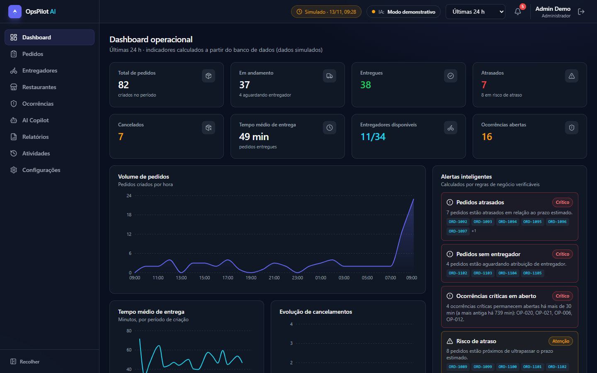
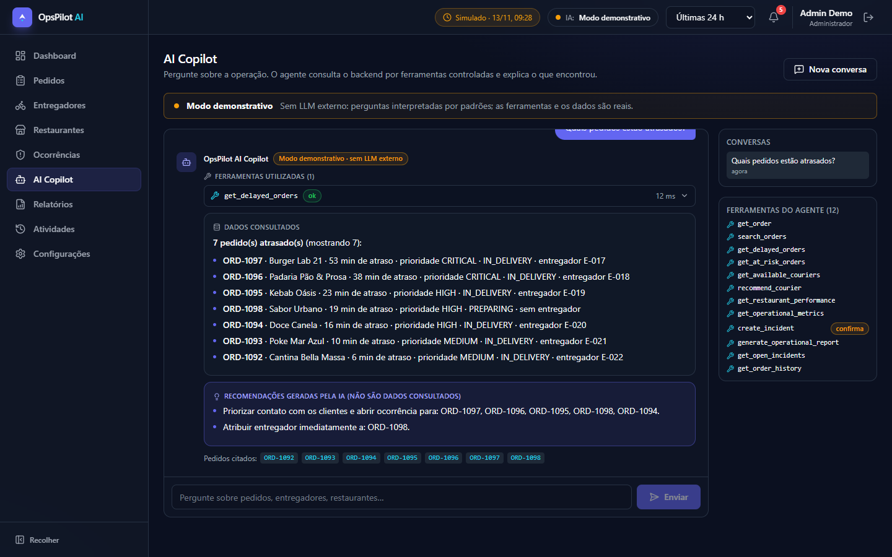
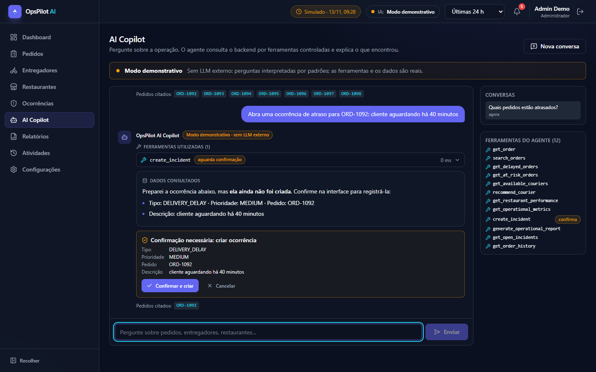
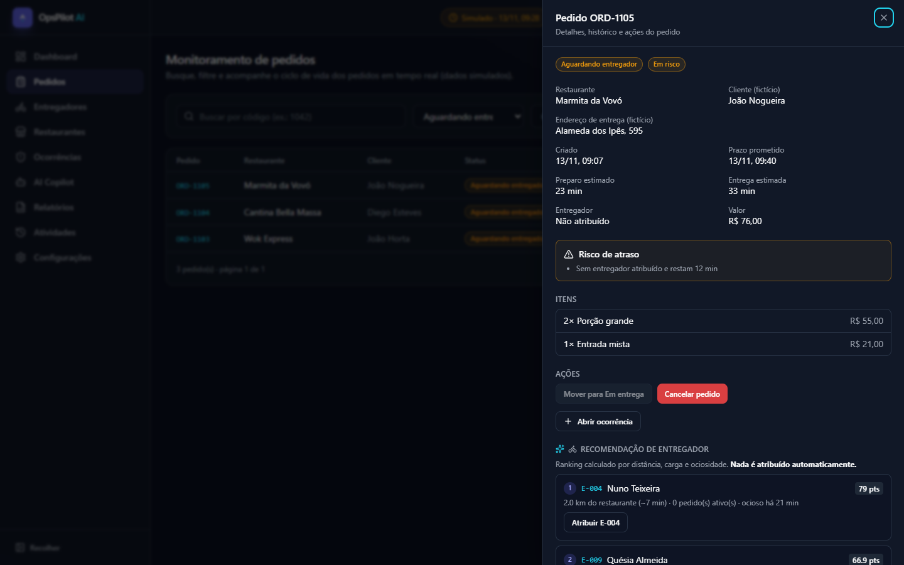
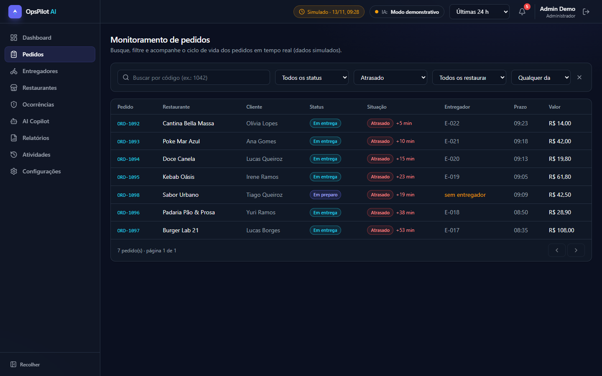
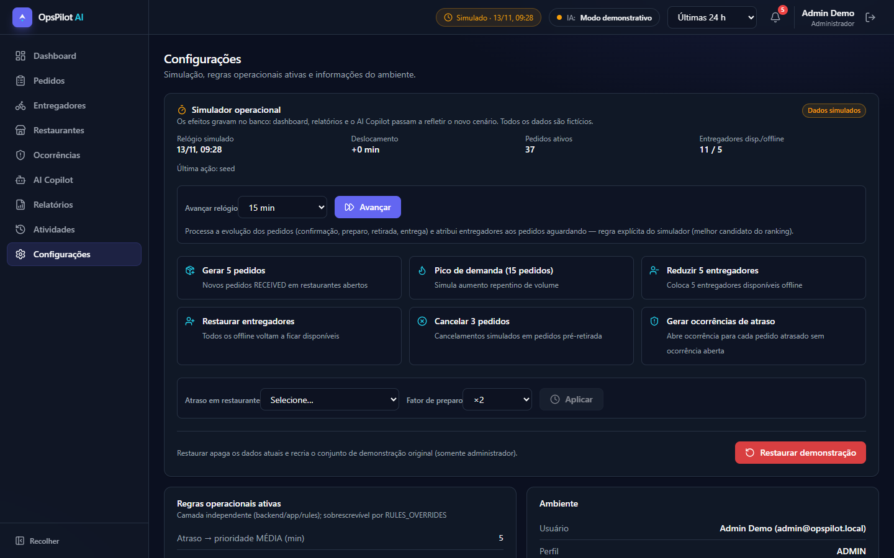
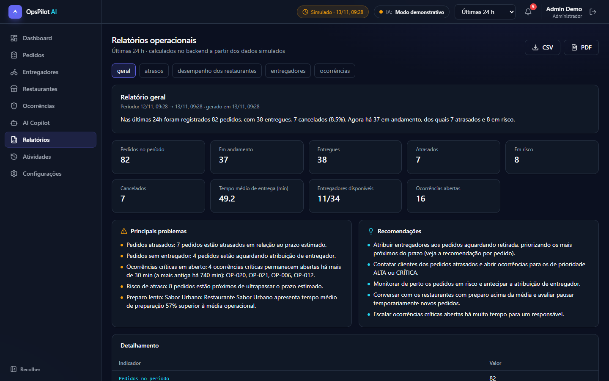
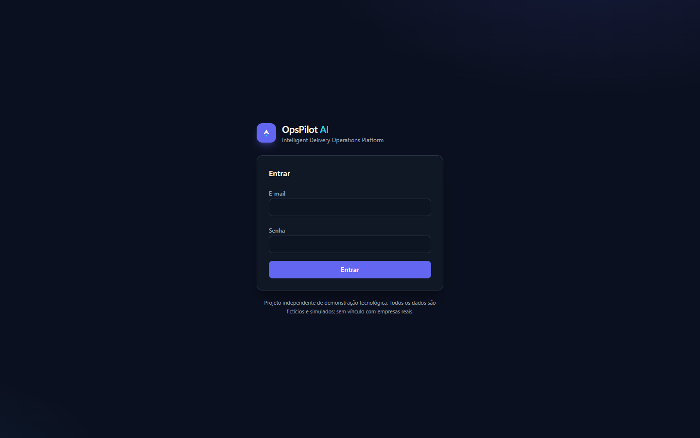

# OpsPilot AI — Intelligent Delivery Operations Platform

> An AI-powered delivery operations platform featuring intelligent monitoring, operational analytics, and tool-using AI agents.

[](https://github.com/gabrigout/opspilot-ai/actions/workflows/ci.yml)
[](LICENSE)


**🇧🇷 Português** (principal) · **🇬🇧 [English summary](#english-summary)**

### ▶️ Abrir a aplicação (sem instalar nada)

[](https://codespaces.new/gabrigout/opspilot-ai?quickstart=1)

O botão acima cria um ambiente na nuvem do GitHub (conta GitHub gratuita; usa a cota gratuita do Codespaces) que executa `docker compose up` e abre o app na porta **8080**. O primeiro build leva alguns minutos. Login de demonstração: `admin@opspilot.local` / `opspilot-demo`. A porta é privada para quem criou o Codespace.

> Não há demo pública hospedada: o app precisa de backend e banco, e o GitHub Pages só serve sites estáticos. Para rodar no seu computador, veja [Como executar](#como-executar).

**Sumário:** [O que é](#o-que-é) · [Funcionalidades](#funcionalidades) · [Tecnologias](#tecnologias) · [Arquitetura](#arquitetura-resumo) · [Demonstração visual](#demonstração-visual) · [Como executar](#como-executar) · [IA](#como-configurar-a-ia) · [Testes](#como-executar-os-testes) · [Limitações](#limitações-conhecidas)

> ⚠️ **Projeto independente de demonstração tecnológica.** Inspirado em desafios reais de logística e delivery, mas **sem qualquer vínculo com empresas reais**: não usa marcas, logotipos ou dados proprietários. **Todos os dados (restaurantes, clientes, entregadores, pedidos) são fictícios e simulados.**

## O que é

O OpsPilot AI centraliza o monitoramento de uma operação de delivery (pedidos, entregadores, restaurantes, ocorrências) num painel administrativo e oferece o **OpsPilot AI Copilot**: um agente que **usa ferramentas reais do backend** (tool calling) para consultar pedidos atrasados ou em risco, analisar desempenho, recomendar entregadores, gerar relatórios e propor a abertura de ocorrências — sempre explicando as recomendações com dados concretos e separando o que foi *consultado* do que foi *sugerido pela IA*.

### Problema que resolve
Numa operação de delivery muitas variáveis mudam ao mesmo tempo (volume, tempo de preparo, entregadores, deslocamento, cancelamentos, reclamações). Quando essas informações ficam espalhadas, perceber cedo que um pedido vai atrasar é difícil. O projeto reúne tudo em regras verificáveis, alertas e um agente que interpreta o cenário.

## Funcionalidades

- **Dashboard**: 8 KPIs calculados do banco, 6 gráficos com seletor de período, alertas (informativo / atenção / crítico) por regras de negócio e feed de atividades.
- **Pedidos**: busca por código, filtros (status, restaurante, período, situação), detalhe, histórico de eventos, máquina de estados com transições validadas, detecção de **atraso** e **risco de atraso** com justificativas.
- **Entregadores**: disponibilidade, carga, histórico, alerta de falta de capacidade e **ranking de recomendação** (distância, carga, ociosidade, equidade). Nunca atribui sozinho: a atribuição é humana.
- **Restaurantes**: desempenho (preparo médio vs. média da operação, cancelamentos, atrasos) e pedidos relacionados.
- **Ocorrências**: criar, associar a pedido, priorizar, atribuir responsável, resolver e consultar o histórico completo de alterações.
- **AI Copilot**: 12 ferramentas, ciclo de tool calling com limites, modo demonstrativo (sem LLM externo) e provedor Anthropic, confirmação humana para ações que gravam dados, auditoria de execuções.
- **Relatórios**: geral, atrasos, restaurantes, entregadores e ocorrências, calculados no backend, com exportação **CSV e PDF**.
- **Simulador**: avançar o relógio, gerar pedidos/pico de demanda, reduzir entregadores, atrasar restaurantes, cancelar pedidos, gerar ocorrências e restaurar o cenário — tudo grava no banco e aparece no dashboard, nos relatórios e no agente.
- **Segurança**: login JWT com expiração, bcrypt, papéis (admin/operador/leitor), CORS restrito, validação de entrada, erros sem vazamento interno.

## Tecnologias

| Camada | Stack |
|---|---|
| Frontend | React 19, TypeScript, Vite, Tailwind CSS v4, componentes no estilo shadcn/ui (Radix), Lucide, Recharts, TanStack Query, React Router, React Hook Form + Zod |
| Backend | Python 3.12, FastAPI, Pydantic, SQLAlchemy 2, Alembic, Uvicorn |
| Banco | PostgreSQL (SQLite para execução local sem Docker e nos testes) |
| IA | SDK oficial da Anthropic (opcional) + provedor demonstrativo próprio |
| Infra | Docker, Docker Compose, GitHub Actions, configs para Vercel e Render |
| Testes | Pytest + HTTPX/TestClient, Vitest + React Testing Library |

## Arquitetura (resumo)

```
React SPA ──JWT/JSON──► FastAPI: api → services → rules (funções puras)
                                   └ agents → tools → services ─► PostgreSQL
                                        └ providers: Anthropic | Demo
```
Regras de negócio ficam em `backend/app/rules` (puras, configuráveis, testadas) — nunca em componentes React nem em prompts. Detalhes em [docs/ARCHITECTURE.md](docs/ARCHITECTURE.md), [docs/AI_AGENT.md](docs/AI_AGENT.md), [docs/API.md](docs/API.md), [docs/DATABASE.md](docs/DATABASE.md), [docs/SECURITY.md](docs/SECURITY.md), [docs/DEPLOYMENT.md](docs/DEPLOYMENT.md), [docs/ROADMAP.md](docs/ROADMAP.md).

## Demonstração visual

Capturas reais da aplicação rodando em Docker (dados fictícios do simulador, Copilot em modo demonstrativo).

**Dashboard operacional** — KPIs calculados do banco, gráficos por período e alertas gerados por regras de negócio:



**AI Copilot com tool calling** — a ferramenta usada, os *dados consultados* e as *recomendações da IA* ficam separados, com referências aos pedidos:



**Confirmação humana** — o agente só *propõe* a criação de uma ocorrência; ela só é gravada depois que o usuário confirma:



**Pedido com recomendação de entregador** — ranking explicável (distância, carga, ociosidade); nada é atribuído automaticamente:



| Monitoramento de pedidos | Simulador operacional |
|---|---|
|  |  |

| Relatórios (CSV/PDF) | Login |
|---|---|
|  |  |

## Como executar

### Opção A — Docker Compose (PostgreSQL)
```bash
cp .env.example .env        # opcional: os padrões já funcionam localmente
docker compose up --build
```
- Aplicação: <http://localhost:8080> · API/Swagger: <http://localhost:8000/api/v1/docs>
- O backend aplica as migrações Alembic e popula dados fictícios quando o banco está vazio.

### Opção B — Sem Docker (SQLite)
Requisitos: Python 3.12+ e Node 22+.
```bash
# terminal 1 – backend
cd backend
python -m venv .venv
.venv\Scripts\activate          # Linux/macOS: source .venv/bin/activate
pip install -r requirements.txt
uvicorn app.main:app --reload --port 8000     # cria o SQLite e popula os dados na primeira execução

# terminal 2 – frontend
cd frontend
npm ci
npm run dev                      # http://localhost:5173 (proxy automático para :8000)
```

### Credenciais de demonstração (somente ambiente local)
| Perfil | E-mail | Senha |
|---|---|---|
| Administrador | `admin@opspilot.local` | `opspilot-demo` |
| Operador | `operador@opspilot.local` | `opspilot-demo` |
| Leitor (somente leitura) | `viewer@opspilot.local` | `opspilot-demo` |

Esses usuários **não são criados** com `ENVIRONMENT=production`.

### Roteiro rápido de demonstração
1. Entre como administrador → **Dashboard**: veja alertas críticos e KPIs.
2. **AI Copilot** → "Quais pedidos estão atrasados?" → veja a ferramenta usada, os dados e as recomendações.
3. Pergunte "Qual entregador recomenda para ORD-xxxx?" (use um código da lista) e depois "Abra uma ocorrência de atraso para ORD-xxxx: cliente aguardando há 40 minutos" → confirme na interface.
4. **Configurações → Simulador** → "Pico de demanda" e "Avançar 15 min" → volte ao Dashboard e ao Copilot e compare.
5. **Relatórios** → exporte CSV/PDF.

## Como configurar a IA

Sem chave, o Copilot funciona em **modo demonstrativo** (indicado em destaque na interface). Para usar um LLM real:
```env
# backend/.env  (ou variáveis de ambiente / .env na raiz com Docker)
AI_PROVIDER=auto                 # auto | anthropic | demo
ANTHROPIC_API_KEY=sk-ant-...
ANTHROPIC_MODEL=claude-sonnet-5-5
```
Reinicie o backend; o indicador no cabeçalho passa a mostrar `anthropic · <modelo>`. A chave nunca vai ao navegador. Detalhes e segurança em [docs/AI_AGENT.md](docs/AI_AGENT.md).

## Como executar os testes

```bash
cd backend && pip install -r requirements-dev.txt && pytest -q && ruff check app tests
cd frontend && npm ci && npm test && npm run build
```

### Resultados da última execução (Windows, Python 3.12.10, Node 24, PostgreSQL 18 via WSL)
| Suíte | Comando | Resultado |
|---|---|---|
| Backend (regras, API, serviços, ferramentas, agente demonstrativo, falhas do provedor, segurança, config de produção) em SQLite | `pytest -q` | **110 passaram**, 0 falhas |
| Backend em **PostgreSQL 18** (esquema criado pela migração Alembic) | `TEST_DATABASE_URL=postgresql+psycopg://… pytest -q` | **106 passaram**, 0 falhas (execução anterior aos 4 testes de configuração mais recentes, que rodam em SQLite) |
| Backend – lint | `ruff check app tests` | sem problemas |
| Frontend (utilitários, cliente HTTP, sessão, componentes, formulários, páginas, Copilot) | `npm test` (Vitest) | **25 passaram** em 4 arquivos |
| Frontend – tipos e build de produção | `npm run build` | sucesso (code splitting por rota) |
| Migrações Alembic | `alembic upgrade head` / `downgrade base` | sucesso em SQLite e PostgreSQL |
| Fluxo ponta a ponta (proxy do frontend → FastAPI → PostgreSQL): login, KPIs, atraso, recomendação e atribuição, transição inválida, ocorrência + histórico, Copilot + confirmação, PDF/CSV, simulação, reset | script de verificação | **20/20** |
| **Docker Compose** (db + backend + frontend/nginx) | `docker compose up -d --build` | 3 contêineres `healthy`; roteiro ponta a ponta **20/20** via `http://localhost:8080`; logs sem erros; login pela interface |
| Auditoria de dependências | `npm audit`, `pip-audit` | sem vulnerabilidades conhecidas |

Também foi feita verificação manual no navegador (desktop e celular 375 px, sem rolagem horizontal). **Não executados:** testes E2E de navegador (Playwright) e a API real da Anthropic.

## Estrutura de diretórios

```
opspilot-ai/
├── backend/
│   ├── app/
│   │   ├── api/ (routers)   ├── core/ (config, db, security, errors)
│   │   ├── models/          ├── schemas/ (request bodies)
│   │   ├── services/        ├── rules/ (regras puras e configuráveis)
│   │   ├── agents/ (copilot, providers, demo, security)
│   │   ├── tools/ (12 ferramentas)   ├── prompts/
│   │   ├── cli.py           └── main.py
│   ├── migrations/ (Alembic)   ├── tests/   ├── Dockerfile   └── requirements*.txt
├── frontend/ (src/{components,pages,layouts,hooks,lib,types,test}, Dockerfile, nginx.conf, vercel.json)
├── docs/ (arquitetura, API, banco, IA, segurança, deploy, roadmap, images/)
├── .github/ (workflows/ci.yml, dependabot, templates de issue/PR)
├── .devcontainer/ (GitHub Codespaces)
├── docker-compose.yml   docker-compose.prod.yml   render.yaml
└── .env.example   LICENSE   CONTRIBUTING.md   SECURITY.md
```

## Limitações conhecidas

- **Docker:** o `docker compose up` foi executado e validado localmente (db, backend e frontend `healthy`, roteiro ponta a ponta 20/20 pelo nginx, logs sem erros). Em máquinas com pouca RAM (≈4 GB) limite o WSL com um `.wslconfig` (`memory=2GB`) e espere 1–2 min pelo engine e vários minutos pelo primeiro build. Veja [docs/DEPLOYMENT.md](docs/DEPLOYMENT.md).
- Os dados de demonstração são relativos ao momento da criação do banco: com o tempo, mais pedidos aparecem como atrasados. Use *Restaurar demonstração* para recomeçar.
- O provedor Anthropic foi testado com um provedor falso (loop, limites, falhas, injeção), **não** contra a API real. O modo demonstrativo reconhece apenas padrões pré-definidos e não "raciocina".
- Sem suíte de testes E2E de navegador no repositório; a interface foi verificada manualmente (desktop e celular), por testes de componentes e por um roteiro de API ponta a ponta. As capturas de tela foram geradas automaticamente com Edge headless.
- Revogação de token e limites de taxa são em memória (por processo). JWT em `localStorage`. Veja [docs/SECURITY.md](docs/SECURITY.md).
- Distâncias em linha reta, sem rotas ou trânsito; localizações simuladas.
- **Sem demo pública hospedada com backend.** Há configurações para Vercel/Render ([docs/DEPLOYMENT.md](docs/DEPLOYMENT.md)), mas o backend não foi implantado; use o Codespaces ou o Docker para ver o app funcionando. O botão de Codespaces depende da sua cota gratuita do GitHub e **não foi testado** de ponta a ponta pelo autor (a configuração `.devcontainer` segue o padrão docker-in-docker; o `docker compose` que ele executa foi validado localmente).

## Roadmap
Veja [docs/ROADMAP.md](docs/ROADMAP.md).

## Contribuindo e licença
[CONTRIBUTING.md](CONTRIBUTING.md) · Licença [MIT](LICENSE).

---

## English summary

**OpsPilot AI** is an independent demo platform for delivery operations: a React/TypeScript dashboard plus a FastAPI/PostgreSQL backend and an **AI Copilot that calls real backend tools** (12 tools: delayed/at-risk orders, courier recommendation, restaurant performance, metrics, reports, incidents…) through an explicit, bounded tool-calling loop. It runs in **demo mode without any API key** (clearly labelled, no pretend LLM) or with the Anthropic API.

- Rule-based delay/risk detection in a pure, configurable, tested layer (`backend/app/rules`).
- Human-in-the-loop: the agent never assigns couriers and cannot create incidents without explicit user confirmation.
- A user-controlled simulator (advance the clock, demand spikes, courier outages, slow kitchens) writes to the real database, so dashboards, reports and the agent all reflect it.
- Auth (JWT, roles), CSV/PDF reports, Alembic migrations, Docker Compose, GitHub Actions, Vercel/Render configs.

**Quick start:** `docker compose up --build` → <http://localhost:8080> (login `admin@opspilot.local` / `opspilot-demo`, local only). Without Docker: see *Opção B* above. In the cloud: [](https://codespaces.new/gabrigout/opspilot-ai?quickstart=1) (uses your free Codespaces quota; the devcontainer runs the same `docker compose`).
**Verified:** 110 backend tests (SQLite; 106 also on PostgreSQL), 25 frontend tests, Docker Compose stack healthy with a 20/20 end-to-end check, CI green. **Not verified:** a live Anthropic key, browser E2E suite, the Codespaces button itself.
**Disclaimer:** independent project, fictitious simulated data, no affiliation with any company. There is no hosted public demo with a backend. See *Limitações conhecidas* for what was and was not verified.
